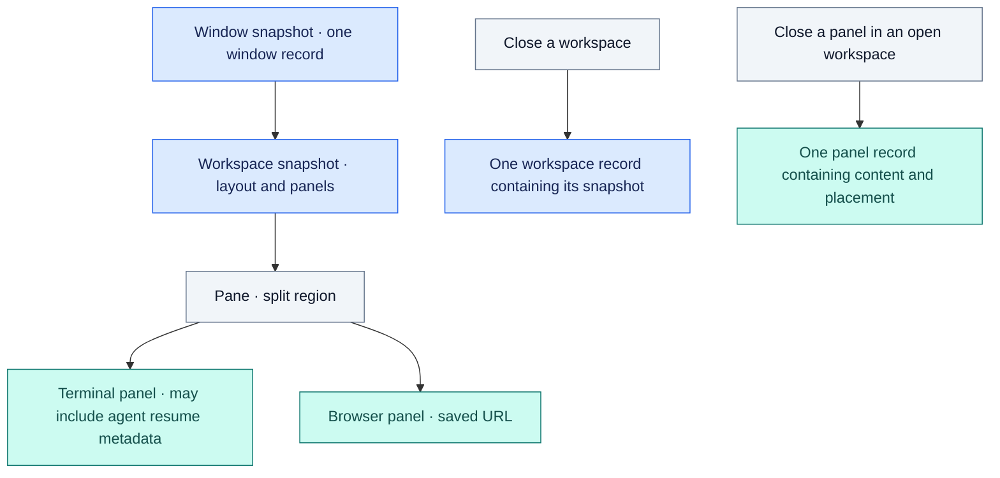
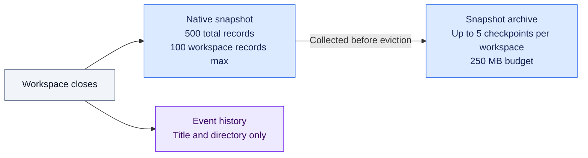
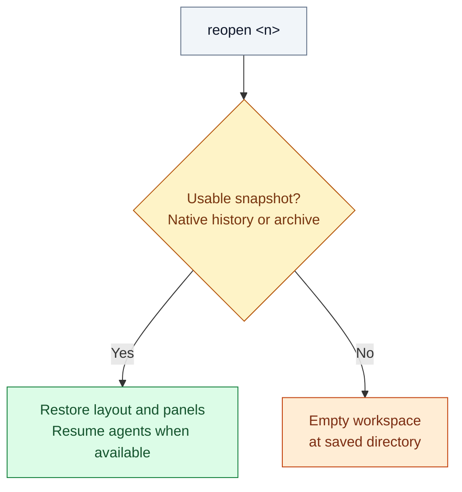

# cmux closed-item history and snapshot retention

These notes describe the installed **cmux 0.65.2 (111), commit `9d01f956c`**,
checked during the October 21, 2026 investigation.

## Name and location

cmux's recently closed storage is called **closed-item history** internally.
The relevant types include `ClosedItemHistoryRecord`, `ClosedItemHistoryEntry`,
and `ClosedItemHistoryStore`. It supplies the app's **History** menu.

Its persisted file for the standard macOS app is:

```text
~/Library/Application Support/cmux/closed-item-history-com.cmuxterm.app.json
```

## What counts as a record

Each record has an ID, a close timestamp, and one of three entry types:

| Entry type | Saved content |
| --- | --- |
| `panel` | One surface's content, such as a terminal or browser tab, plus its pane placement |
| `workspace` | A workspace snapshot containing its pane layout and panels |
| `window` | A macOS window snapshot containing its workspaces |

A **pane** is a split region that can contain several surface tabs. Panes have
no separate history entry type. A workspace record can contain many panes,
terminals, and browsers while still counting as one record.

An agent runs inside a terminal panel. Its snapshot may include session resume
metadata when cmux has captured the necessary binding.



The nesting shows snapshot contents, not additional history records: saving a
window or workspace does not count every nested panel as a separate record.

## Closing an agent pane in an open workspace

Closing a pane containing one agent terminal normally adds one **`panel`**
history record, even while the workspace remains open. Closing a pane with
multiple tabs can add multiple panel records.

This saves the closed panels; it does not create a new whole-workspace history
snapshot for each panel closure.

## Retention limits in cmux 0.65.2

The installed build configures two limits:

- **500 total records**, shared across panel, workspace, and window entries.
- **100 workspace records**, as an additional limit on workspace entries.

When the total limit is exceeded, older records are removed. New terminal or
browser closures can therefore evict older whole-workspace snapshots, even
when fewer than 100 workspace records remain.

During the investigation, the native history file contained **497 panel
records and 3 workspace records**. The close event for
`bambu-printer-cmd-center` remained in the manager's event history, but its
matching native workspace snapshot was absent.

Workspace events can preserve a title and directory without preserving the
terminal/browser layout. Consequently, an entry can remain visible to
`cmux-ws-manager` after its restorable snapshot has aged out. Without another
saved snapshot, reopening that entry can only create an empty workspace.

**What survives a close**



The event history keeps an entry discoverable; it does not back up the native
snapshot. More panel, workspace, and window closures can evict older native
snapshots. The manager's separate archive, `~/.cmuxterm/workspace-snapshots.jsonl`,
preserves snapshots it successfully observes and saves before eviction; it
cannot recover snapshots already lost.

The manager's background collector watches native history changes and checks
every 60 seconds while logged in. It deduplicates equivalent restorable content,
keeps older checkpoints spread over time, and protects the newest usable copy
plus an earlier fuller layout when the latest usable state is a bare shell.
At capacity, optional checkpoints are pruned before new saves are refused;
protected recovery copies are not silently evicted. `archive status` reports
capacity and collection failures, and `archive versions <n>` lists recovery
checkpoints. See the [retention policy](../README.md#snapshot-retention-and-background-collection).

**What reopening restores**



Agent resumption requires captured session metadata. `reopen <n> --plain`
explicitly chooses an empty workspace even when a snapshot is available.

## Sources

Checked October 21, 2026 · cmux 0.65.2 (111).

- [Installed-build history types and retention defaults](https://github.com/manaflow-ai/cmux/blob/9d01f956c/Sources/ClosedItemHistory.swift#L133-L138)
- [GitHub HEAD retention defaults verified October 21, 2026](https://github.com/manaflow-ai/cmux/blob/7dcc70fdc129cc1686c8ca03fecd96ba09c53cf6/Sources/ClosedItemHistory.swift#L130-L139)
- [History capacity policy](https://github.com/manaflow-ai/cmux/blob/9d01f956c/Sources/ClosedItemHistoryCapacityPolicy.swift)
- [Panel and pane closure handling](https://github.com/manaflow-ai/cmux/blob/9d01f956c/Sources/Workspace.swift)
